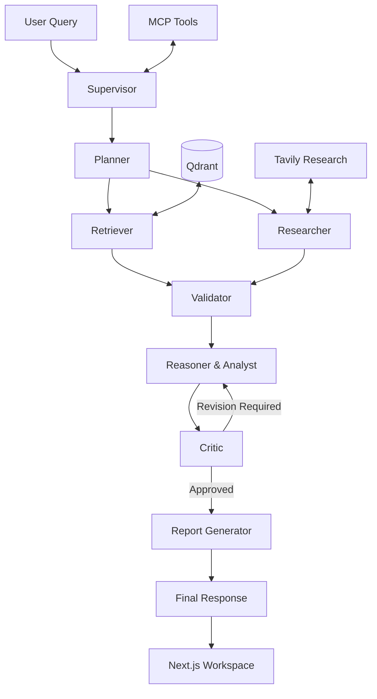
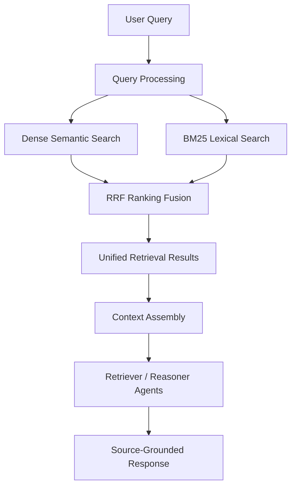
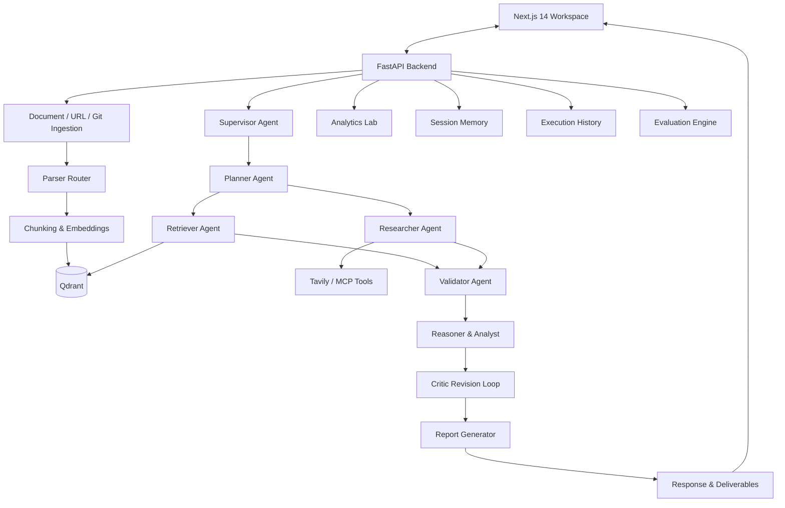

# 🛡️ AEGIS AI | AgentSwarm
### Multi-Agent AI Orchestration & Autonomous Intelligence Platform

<p align="center">
  <strong>Eight specialized agents. Parallel intelligence. One coordinated AI workflow.</strong>
</p>

<p align="center">
  
  
  
  
  
  
  
  
</p>

---

## 🚀 Overview

**AEGIS AI (AgentSwarm)** is a multi-agent AI orchestration platform that transforms conventional document question-answering into a structured, collaborative intelligence workflow.

Instead of depending on a single LLM call, AegisAI coordinates eight specialized agents through a LangGraph StateGraph. Each agent contributes to a dedicated stage of planning, information retrieval, research, validation, reasoning, critical evaluation, and report generation.

The platform combines Agentic Retrieval-Augmented Generation (Agentic RAG), hybrid search, resilient multi-provider LLM orchestration, multimodal document ingestion, statistical analytics, and real-time execution monitoring.

AegisAI is designed to handle more than conversational queries. It can ingest documents, investigate web sources, analyze structured datasets, coordinate specialized agents, evaluate generated responses, and produce professional deliverables.

### What makes AegisAI different?

- **Multi-agent intelligence:** Eight specialized agents with coordinated responsibilities.
- **Resilient LLM infrastructure:** Automatic provider failover across Gemini, Groq, and OpenLM.
- **Universal ingestion:** 19 supported document, spreadsheet, image, and archive formats, plus URL and Git repository ingestion.
- **Hybrid Agentic RAG:** Dense semantic search and BM25 lexical retrieval combined through RRF.
- **External tool intelligence:** MCP integration and Tavily web research.
- **Analytical computation:** Deterministic statistical profiling, anomaly detection, and regression.
- **Professional deliverables:** Seven export formats.
- **Evaluation and observability:** Seven live response-quality metrics and execution monitoring.

---

# 🧠 1. Multi-Agent Orchestration Engine

The core of AegisAI is an eight-agent LangGraph StateGraph architecture that distributes complex tasks across specialized agents.

Rather than asking one model to perform every operation, the system coordinates agents through a shared workflow state, conditional execution, parallel processing, and iterative response refinement.

### The Eight Specialized Agents

| Agent | Role and Responsibilities |
|---|---|
| Supervisor | Coordinates the workflow, delegates responsibilities, and manages agent execution. |
| Planner | Interprets the user's query and decomposes complex requests into actionable subtasks. |
| Retriever | Searches indexed documents and retrieves relevant contextual evidence. |
| Researcher | Investigates information using available research sources and external tools. |
| Validator | Evaluates retrieved information and checks the relevance and suitability of supporting evidence. |
| Reasoner & Analyst | Synthesizes retrieved information, connects findings, and develops structured conclusions. |
| Critic | Reviews generated responses, identifies weaknesses, and initiates revision when required. |
| Report Generator | Converts the approved output into a structured, user-facing response or report. |

### Advanced Orchestration Features

- LangGraph StateGraph-based agent coordination.
- Parallel execution of Retriever and Researcher agents.
- Shared workflow state and agent communication.
- Conditional routing between workflow stages.
- Critic-driven response revision loop.
- Multi-stage validation and reasoning.
- Execution-level agent progress tracking.
- Server-Sent Events (SSE) for live agent-progress streaming.

### Execution Flow



### Why this architecture?

Complex queries frequently require multiple operations: understanding the request, locating evidence, investigating external information, checking results, and synthesizing conclusions.

Separating these responsibilities makes the workflow modular, inspectable, and easier to evaluate than a conventional single-prompt architecture.

---

# 🔄 2. Resilient Multi-Provider LLM Architecture

AegisAI incorporates a custom `AutoFallbackLLM` architecture to reduce dependency on a single language-model provider.

### Supported LLM Providers

- Google Gemini 2.5 Flash.
- Groq API.
- OpenLM.

### AutoFallbackLLM Capabilities

**Automatic Provider Failover**

When a configured provider encounters a supported failure, the application can switch to another available provider instead of immediately terminating the entire LLM workflow.

**Multi-Key Rotation**

Multiple configured API keys can be rotated to handle provider-specific rate limits and availability constraints.

**Thread-Safe Execution**

Thread-safe fallback handling helps prevent concurrent requests from interfering with shared provider and key-rotation state.

**Centralized Model Integration**

The application uses a common LLM abstraction to integrate different providers into its agent workflows.

### Benefits

- Improved provider availability.
- Reduced single-provider dependency.
- Better handling of rate limits and upstream failures.
- Flexible model-provider configuration.
- More resilient conversational execution.

---

# 📚 3. Document Intelligence & Multimodal Ingestion

AegisAI implements a multi-parser ingestion router designed to process heterogeneous information sources and prepare them for retrieval.

### Supported Input Sources

The ingestion pipeline supports 19 document, spreadsheet, image, and archive formats, along with:

- Web URL ingestion.
- Git repository ingestion.
- PDF and office documents.
- Structured tabular datasets.
- OCR-supported image content.
- Additional supported archive formats.

### Multi-Parser Processing Architecture

| Technology | Function |
|---|---|
| PyMuPDF | Fast PDF text extraction and document processing. |
| Docling | Structured document understanding and extraction. |
| pypdf | Additional PDF parsing and processing. |
| PaddleOCR | OCR-based extraction from scanned or image-based content. |
| RapidOCR | Alternative OCR processing for supported image inputs. |
| pandas | Structured spreadsheet and tabular data processing. |

The ingestion router uses format-aware and selective parser execution instead of forcing every document through a single extraction method.

### Intelligent Document Processing Pipeline

1. **Source Identification:** Detect whether the input is a document, image, URL, Git repository, or structured dataset.
2. **Parser Routing:** Select the appropriate parser based on the input type.
3. **Content Extraction:** Extract textual, tabular, and OCR-derived content.
4. **Preprocessing:** Normalize and prepare the extracted information.
5. **Document-Aware Chunking:** Split content while preserving useful contextual boundaries.
6. **Embedding Generation:** Generate vector representations using the configured embedding model.
7. **Vector Indexing:** Store searchable document chunks and associated metadata in Qdrant.

### Document-Aware Chunking

| Parameter | Configuration |
|---|---|
| Target chunk size | 900 words |
| Chunk overlap | 10% |
| Chunking strategy | Document-aware |
| Embedding models | BGE-M3 and all-MiniLM-L6-v2 |
| Vector database | Qdrant |

The overlap helps preserve contextual continuity between adjacent chunks, reducing information loss at chunk boundaries.

---

# 🔎 4. Agentic RAG & Hybrid Retrieval Engine

AegisAI combines dense semantic retrieval and BM25 lexical retrieval to improve the quality and coverage of retrieved document context.

### Embedding Models

**BGE-M3**
- Used for semantic representation of document content.
- Supports dense embedding-based retrieval.

**all-MiniLM-L6-v2**
- Lightweight sentence-transformer embedding model.
- Provides an alternative embedding configuration for supported workflows.

### Dense Semantic Retrieval

Dense retrieval converts user queries and document chunks into vector representations and searches Qdrant for semantically related content.

It helps retrieve information even when the wording of the query differs from the original document.

### BM25 Lexical Retrieval

BM25 complements semantic search by matching relevant keywords and terminology.

It is particularly useful when exact names, technical terms, identifiers, and phrases matter.

### Reciprocal Rank Fusion (RRF)

The two retrieval channels produce independently ranked results. RRF combines their rankings into a unified result list.

This provides a hybrid approach that benefits from both semantic relevance and keyword-level matching.

### Retrieval Pipeline



### Additional Capabilities

- Qdrant vector indexing and retrieval.
- Hybrid dense and lexical search.
- RRF-based result fusion.
- Metadata-aware document retrieval.
- Contextual information assembly.
- Citation-enabled responses.
- Integration with the multi-agent reasoning pipeline.

---

# 🌐 5. MCP Integration & Tavily Web Research

AegisAI extends its intelligence beyond locally indexed documents through external tool integration.

### Model Context Protocol (MCP)

MCP integration provides a standardized mechanism for connecting agents with supported external tools.

Key capabilities include:

- MCP-compatible tool integration.
- JSON-RPC 2.0 communication.
- Structured tool requests and responses.
- External tool discovery and execution.
- Integration with the agent orchestration workflow.

### Tavily Research Integration

Tavily provides web research capabilities to the Researcher workflow.

The integration enables:

- Live web information discovery.
- External source retrieval.
- Research-assisted question answering.
- Additional evidence beyond indexed documents.
- Combining internal knowledge with external research.

Together, MCP and Tavily extend AegisAI from a document-retrieval application into a tool-enabled research and reasoning platform.

---

# 📊 6. Analytics Lab & Intelligent Data Analysis

AegisAI includes a dedicated Analytics Lab for deterministic statistical computation and dataset exploration.

Unlike approaches that rely exclusively on LLM-generated numerical answers, the Analytics Lab performs analytical operations using Python's established data-science libraries.

### Statistical Profiling

- Dataset inspection and profiling.
- Descriptive statistical summaries.
- Mean, median, standard deviation, and distribution analysis.
- Feature-level statistical information.
- Numerical relationship analysis.

### Correlation Analysis

- Pearson correlation for measuring linear relationships.
- Spearman correlation for measuring rank-based monotonic relationships.
- Correlation-based feature exploration.

### Anomaly Detection

**IQR-Based Detection**

Identifies observations outside the interquartile-range boundaries.

**Z-Score Detection**

Identifies observations that deviate significantly from the statistical mean in standard-deviation units.

### Regression Analysis

- Linear regression.
- Feature relationship analysis.
- Trend estimation.
- Statistical interpretation of relationships.

### Visualization Engine

Matplotlib generates labeled analytical visualizations, including:

- Statistical distribution charts.
- Correlation visualizations.
- Regression plots.
- Anomaly-related visualizations.
- Dataset-level analytical charts.

### Explanatory Takeaways

The analytics workflow combines computed statistical results with explanatory insights, making analytical outputs easier to understand rather than presenting charts without interpretation.

### Technology Stack

- pandas.
- NumPy.
- SciPy.
- scikit-learn.
- Matplotlib.

---

# 📄 7. Seven-Format Deliverables Hub

AegisAI includes an execution-linked export engine that transforms analysis outputs, AI-generated responses, and structured results into professional deliverables.

### Supported Export Formats

| Format | Capabilities |
|---|---|
| PDF | Formatted reports and analytical documents. |
| DOCX | Editable Microsoft Word documents. |
| PPTX | Presentation-ready 16:9 slide decks. |
| XLSX | Multi-sheet Excel workbooks. |
| CSV | Structured tabular data exports. |
| HTML | Browser-ready reports and documents. |
| Markdown | Technical documentation and structured text reports. |

### Export Engine Features

- Seven distinct output formats.
- Execution-linked deliverable generation.
- Structured report formatting.
- Multi-sheet spreadsheet generation.
- 16:9 presentation generation.
- Reusable analytical and documentation outputs.

The goal is to make the output of an AI workflow useful beyond the chat interface.

---

# 📈 8. Evaluation, Observability & Seven Live Quality Metrics

AegisAI incorporates an evaluation layer to monitor response quality, retrieval performance, and task execution.

### Seven Quality Metrics

| Metric | What It Evaluates |
|---|---|
| Hallucination Rate | Frequency or proportion of responses identified as unsupported or hallucinated. |
| Accuracy | Factual reliability of the generated answer. |
| Correctness | Whether the response correctly addresses the task. |
| Context Precision | Relevance of retrieved information to the query. |
| Context Recall | Coverage of relevant information in the retrieved context. |
| Task Success Rate | Successful completion of the requested workflow. |
| Tool Call Accuracy | Whether the appropriate tools are selected and executed correctly. |

### Evaluation Technologies

**LangSmith**
- Execution tracing.
- LLM workflow observability.
- Latency monitoring.
- Token telemetry.
- Request-level inspection.

**Ragas and DeepEval**
- Retrieval evaluation.
- Context precision and recall assessment.
- Faithfulness and hallucination-related evaluation.
- Response-quality assessment.

The evaluation workflow combines automated quality scoring with execution-level observability to help identify weaknesses in the overall AI pipeline.

---

# 💬 9. Interactive Workspace, Session Memory & Execution History

AegisAI provides a Next.js 14 workspace that exposes the multi-agent workflow through an interactive user interface.

### Frontend Features

- Interactive conversational interface.
- Real-time SSE agent-progress streaming.
- Live workflow execution updates.
- Session-isolated conversation history.
- Disk-persisted chat history.
- Conversation continuity.
- Full multi-agent Execution History inspection.
- Execution-level inspection of agent activity.
- Live response-quality metrics.

### Session Memory

Conversation history is isolated by session and persisted on disk, supporting continuity between interactions without mixing unrelated sessions.

### Execution History

Users can inspect completed multi-agent executions and examine how a workflow progresses through its specialized stages.

### Live Monitoring

The workspace brings together agent-progress updates, execution history, and evaluation information to provide visibility into the system's behavior.

---

# 🏗️ 10. End-to-End Architecture



---

# 🛠️ 11. Complete Technology Stack

| Category | Technologies |
|---|---|
| Frontend | Next.js 14, TypeScript |
| UI | Tailwind CSS, shadcn/ui |
| Backend | Python, FastAPI |
| Agent Orchestration | LangGraph |
| Agent Framework | PydanticAI |
| Data Validation | Pydantic v2 |
| LLM Providers | Gemini 2.5 Flash, Groq API, OpenLM |
| Vector Database | Qdrant |
| Embeddings | BGE-M3, all-MiniLM-L6-v2 |
| Embedding Framework | Sentence Transformers |
| Document Processing | Docling, PyMuPDF, pypdf |
| OCR | PaddleOCR, RapidOCR |
| External Research | Tavily |
| Tool Integration | MCP, JSON-RPC 2.0 |
| Data Processing | pandas, NumPy |
| Statistical Computing | SciPy |
| Machine Learning | scikit-learn |
| Visualization | Matplotlib |
| Observability | LangSmith |
| Evaluation | DeepEval, Ragas |
| Deployment | Docker |
| Streaming | Server-Sent Events (SSE) |

---

# ⚙️ 12. Getting Started

### Prerequisites

- Python 3.11+
- Node.js 20+
- npm
- Docker
- Qdrant instance
- Gemini API credentials
- Optional Groq and OpenLM credentials
- Tavily API credentials for web research

### Clone Repository

```bash
git clone https://github.com/adrika-mandal-tech/AegisAI.git

cd AegisAI
```

### Configure Environment

Create the required environment files using the repository's `.env.example` templates.

Example configuration:

```env
# LLM Providers
GEMINI_API_KEY=
GROQ_API_KEY=
OPENLM_API_KEY=

# Vector Database
QDRANT_URL=
QDRANT_API_KEY=

# External Research
TAVILY_API_KEY=

# Observability
LANGSMITH_TRACING=
LANGSMITH_API_KEY=
LANGSMITH_PROJECT=
```

Refer to the actual backend configuration for the complete environment-variable requirements.

### Start the Backend

Install the dependencies using the project's configured dependency manager.

Launch the FastAPI application using its configured ASGI entry point:

```bash
uvicorn <actual_module>:app --host 0.0.0.0 --port 8000
```

### Start the Frontend

```bash
cd frontend

npm install
npm run dev
```

Open the local development URL provided by Next.js.

For containerized deployment, use the Docker configuration supplied in the repository.

---

# 🔐 13. Security & Reliability

- Environment-based credential management.
- Configurable multi-provider LLM fallback.
- Structured Pydantic-based validation.
- Controlled external tool execution.
- Session-isolated conversation storage.
- Retrieval-grounded response generation.
- Workflow observability and evaluation.

---

# 🗺️ 14. Future Roadmap

- [ ] Advanced adaptive agent routing.
- [ ] Enhanced long-term agent memory.
- [ ] Advanced hybrid retrieval reranking.
- [ ] Expanded MCP integrations.
- [ ] Advanced multimodal reasoning.
- [ ] More comprehensive agent benchmarking.
- [ ] Distributed execution and scalability.
- [ ] Production deployment enhancements.

---

# 🎯 Project Vision

AegisAI explores the next generation of intelligent applications: systems where specialized agents collaborate to solve complex information-processing tasks.

By combining multi-agent orchestration, hybrid retrieval, resilient LLM infrastructure, multimodal ingestion, statistical computation, and evaluation-driven workflows, AegisAI aims to make AI systems more modular, observable, and dependable.

**Not just an AI chatbot. A coordinated multi-agent intelligence system.**

---

## 👩‍💻 Author

**Adrika Mandal**

B.Tech – Computer Science Engineering  
Specialization: Data Science & Artificial Intelligence

- GitHub: [@adrika-mandal-tech](https://github.com/adrika-mandal-tech)
- LinkedIn: [adrika-mandal](https://www.linkedin.com/in/adrika-mandal/)

---

⭐ If you find AegisAI interesting, consider giving the repository a star!
